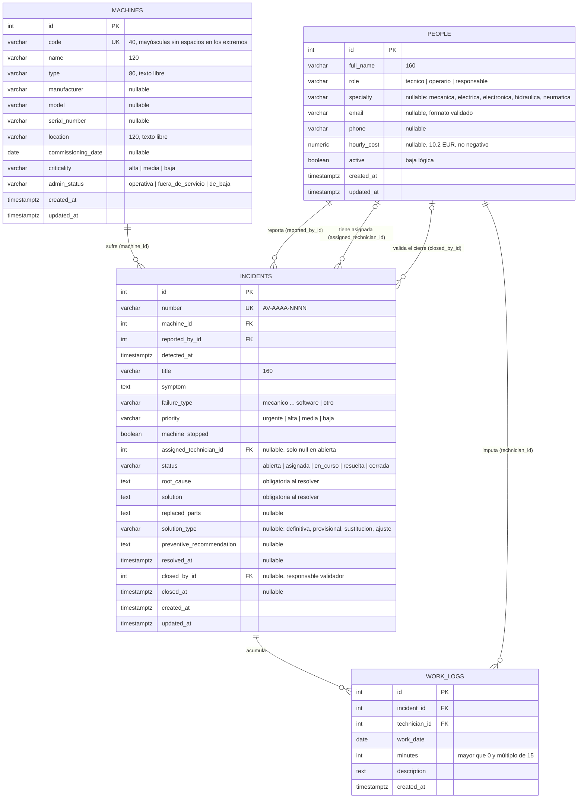

# Gestión de mantenimiento correctivo

Prueba técnica de Téciman Digital: una aplicación web para registrar máquinas y personas,
gestionar cada avería desde su detección hasta su validación, imputar horas de trabajo y
recuperar cómo se arreglaron averías anteriores.

El enunciado original está en [requerimiento.md](requerimiento.md), el contrato funcional en
[spec.md](spec.md) y la guía de arquitectura y trabajo en [AGENTS.md](AGENTS.md).

**Estado: completa.** Las cuatro fases de la spec están hechas: catálogos de máquinas y personas,
el ciclo completo de averías con imputaciones, el histórico de conocimiento, totales de horas por
avería, máquina y técnico, un script de datos demo idempotente y un recorrido completo que
`make verify` ejecuta desde una base vacía.

**Contenido**

1. [Instalación y arranque](#instalación-y-arranque)
2. [Stack elegido y por qué](#stack-elegido-y-por-qué)
3. [Modelo de datos](#modelo-de-datos)
4. [Decisiones de diseño y supuestos](#decisiones-de-diseño-y-supuestos)
5. [Qué mejoraría con más tiempo](#qué-mejoraría-con-más-tiempo)
6. [Referencia técnica](#referencia-técnica): migraciones, verificación, pruebas,
   configuración y API

## Instalación y arranque

Requisitos: Docker con Docker Compose v2 y `make` (opcional: cada objetivo del `Makefile` es una
orden corta que se puede ejecutar a mano).

```bash
cp .env.example .env      # ajusta POSTGRES_PASSWORD y, si hace falta, los puertos
make up                   # docker compose up -d --build
```

Compose levanta tres servicios:

| Servicio | URL | Notas |
| --- | --- | --- |
| `db` | `localhost:5432` | PostgreSQL con volumen persistente `db-data` |
| `backend` | http://localhost:8000 | Aplica `alembic upgrade head` al arrancar. Documentación OpenAPI en `/docs` |
| `frontend` | http://localhost:5173 | Vite en modo desarrollo. Redirige `/api` al backend |

**Datos de demostración.** El backend no carga datos solo. Con los servicios en marcha:

```bash
make seed        # docker compose exec backend python -m scripts.seed_demo
```

Se puede repetir sin duplicar nada: la segunda ejecución informa de que todo «ya existía». Carga:

| Qué | Detalle |
| --- | --- |
| 6 máquinas | `PRE-001` prensa (dos averías abiertas con parada: estado «en avería»), `CNC-002`, `ROB-003`, `CIN-004`, `COM-005` y `HOR-006`, de baja con su historial cerrado |
| 7 personas | Responsables Rosa Martín y Diego Sanz; operaria Olga Pérez; técnicos Tomás García (mecánica), Teresa López (eléctrica) y Hugo Ruiz (hidráulica); Inés Moreno, técnica **inactiva** con imputaciones antiguas |
| 12 averías | 2 abiertas, 2 asignadas, 2 en curso, 2 resueltas y 4 cerradas, con fechas relativas al día de la carga |
| Caso de imputación compartida | *Pérdida de presión en el circuito hidráulico* (PRE-001, cerrada): Tomás 1,25 h + Hugo 0,75 h = 2 h. Su solución aparece buscando «junta tórica» o «purga» en *Histórico* |

Las personas demo usan emails `@demo.teciman.local`. Sin datos demo, la base vacía pide crear el
primer responsable y desde ahí se dan de alta máquinas y personas a mano.

**Recorrido de una avería.** Cambia la «Persona activa» de la cabecera para actuar como cada uno:
Olga registra una parada en *Averías → Registrar avería*, Rosa la asigna a Tomás desde el detalle,
Tomás la inicia, Tomás y Hugo imputan horas, Tomás la resuelve y Rosa la cierra. El detalle solo
muestra las acciones que la persona activa puede hacer en ese estado. Después, *Histórico* la
encuentra por máquina, síntoma, causa o texto de la solución, y las fichas de máquina y de cada
técnico suman sus horas.

El mismo recorrido, automatizado contra la API, con comprobación de rechazos y totales:

```bash
make walkthrough   # docker compose exec backend python -m scripts.walkthrough
```

Escribe una máquina `REC-<marca de tiempo>` y una avería cerrada en la base, así que en la base
de desarrollo deja rastro. `make verify` lo ejecuta en un proyecto temporal.

Si ya usas alguno de esos puertos, cambia `POSTGRES_PORT`, `BACKEND_PORT` o `FRONTEND_PORT` en
`.env`.

Para parar: `make down` (conserva los datos). `docker compose down -v` borra también el volumen
de la base de datos.

## Stack elegido y por qué

| Capa | Tecnología |
| --- | --- |
| Frontend | React 19, React Router 7, Vite 8, TypeScript estricto, ESLint (typescript-eslint), Vitest + Testing Library |
| Backend | Python 3.12+, FastAPI, Pydantic, SQLAlchemy 2, Alembic, uv, Ruff, mypy estricto, pytest |
| Base de datos | PostgreSQL 16 |
| Entorno local | Docker Compose y `Makefile` |

- **FastAPI + Pydantic.** El backend tenía que ser Python. FastAPI valida las peticiones con
  modelos Pydantic tipados, genera la documentación OpenAPI en `/docs` sin trabajo extra (útil
  para revisar la API sin la interfaz) y es lo bastante ligero para un servicio de este tamaño.
  Django habría aportado un panel de administración que aquí no hace falta, a cambio de más
  estructura.
- **PostgreSQL.** Las reglas importantes se aplican también en la base: `CHECK` de coherencia de
  estado, expresiones regulares para el código y el email, claves foráneas `RESTRICT` y una
  secuencia para la numeración. La concurrencia se resuelve con bloqueos de fila
  (`SELECT … FOR UPDATE/SHARE`) y bloqueos consultivos, que SQLite no tiene. Las pruebas corren
  contra el mismo motor que usa la aplicación, así que lo que se prueba es lo que se ejecuta.
- **SQLAlchemy 2 + Alembic.** El enunciado pide crear el esquema con migraciones. SQLAlchemy 2
  da modelos tipados que mypy comprueba y deja escribir en SQL los totales y el tiempo de parada.
  Una prueba compara modelos y migración para detectar deriva.
- **React + Vite + TypeScript.** Una SPA permite hacer todas las operaciones desde la interfaz,
  con acciones que cambian según la persona activa y el estado de la avería. TypeScript estricto
  ayuda a mantener el contrato con la API, Vite arranca en segundos y su proxy de `/api` evita
  configurar CORS en desarrollo. React Router guarda los filtros en la URL, de modo que una
  búsqueda se puede recargar o compartir.
- **uv, Ruff y mypy.** Instalación reproducible con lockfile, y lint y tipos rápidos para que
  `make check` se ejecute a menudo.
- **Docker Compose.** El enunciado pide arranque sencillo: `make up` levanta base de datos,
  backend (con migraciones) y frontend sin instalar nada más que Docker.

```text
backend/    API FastAPI, modelos, migraciones Alembic y pruebas (pytest)
frontend/   Aplicación React + Vite
backend/scripts/
  seed_demo.py    carga idempotente de datos de demostración (make seed)
  walkthrough.py  recorrido completo de la demo contra la API (make walkthrough)
scripts/    verify-stack.sh: verificación de arranque, carga demo y recorrido desde una base vacía
```

## Modelo de datos

Generado a partir de los modelos de `backend/app/models/` y de la migración
`backend/migrations/versions/20261105_0001_esquema_inicial.py`. GitHub dibuja el diagrama
directamente desde este bloque Mermaid; para visores sin Mermaid hay una copia en imagen en
[docs/modelo-de-datos.png](docs/modelo-de-datos.png).



Qué no aparece en las tablas, a propósito:

- **El estado «en avería» de la máquina.** Se guarda solo el estado administrativo
  (`admin_status`). La API calcula el estado efectivo: `en_averia` mientras la máquina tenga
  alguna avería abierta, asignada o en curso con `machine_stopped`.
- **Totales de horas y tiempo de parada.** Se calculan en SQL al consultar: la suma de
  `work_logs.minutes` por avería, máquina o técnico, y las horas entre `detected_at` y
  `resolved_at` cuando hubo parada.
- **El número de avería** sale de la secuencia `incident_number_seq` y del año en que se registra,
  en la zona de operación.

`PEOPLE` tiene cuatro relaciones porque una avería se relaciona con tres personas distintas
(reportante, técnico asignado y responsable que valida) y cada imputación con su técnico. Las
enumeraciones se guardan como `VARCHAR` con `CHECK` y con los valores estables de la API
(`en_curso`, `fuera_de_servicio`…); las etiquetas en español viven en la interfaz.

### Restricciones en la base de datos

- Claves foráneas `RESTRICT`: no se puede borrar físicamente una máquina o persona con historial.
- Código de máquina único y guardado en mayúsculas sin espacios en los extremos. Número de avería
  único con formato `AV-AAAA-NNNN` (cuatro dígitos como mínimo).
- Textos obligatorios sin cadenas vacías ni solo espacios. Email con formato básico y coste por
  hora `NUMERIC(10,2)` no negativo.
- Coherencia de estado en la avería: solo `abierta` carece de técnico asignado; `resuelta` y
  `cerrada` exigen hora de resolución, causa raíz y solución con contenido; solo `cerrada` tiene
  validador y hora de cierre; resolución posterior a la detección y cierre posterior a la
  resolución.
- Imputaciones en minutos enteros, positivos y múltiplos de 15.
- Índices en los campos que filtran listados: estado, prioridad, tipo y ubicación de máquina,
  rol y vigencia de persona, `(machine_id, status)` y `resolved_at` para el histórico.

Las reglas que dependen de otras filas o del momento actual se aplican en los servicios, dentro
de la transacción y con bloqueos de fila: rol técnico del asignado, persona activa, imputación no
anterior al día de detección, detección no futura y estado efectivo de la máquina. Todo el
esquema está en la migración `0001`; las fases 3 y 4 no necesitaron cambios.

## Decisiones de diseño y supuestos

El enunciado deja abiertos varios puntos. Estas son las decisiones tomadas y su motivo; las que
añaden o cambian algo respecto al modelo orientativo del enunciado están justificadas aquí, como
pide.

### Datos guardados y calculados

- **Estado de la máquina.** Se guarda el estado administrativo (`operativa`,
  `fuera_de_servicio`, `de_baja`). `en_averia` no se guarda: la API lo deriva de las averías
  abiertas, asignadas o en curso que causan parada, como indica la spec. Así, al resolver la
  última parada se recupera la condición previa sin tener que recordarla aparte.
- **Tipo y ubicación de máquina** son texto obligatorio y no una lista cerrada. El enunciado da
  ejemplos (prensa, CNC…), pero la spec no fija valores y los necesita para filtrar.
- **Criticidad** es obligatoria. La spec la define como lista cerrada sin valor por defecto.
- **Horas imputadas** se guardan como minutos enteros (spec). La API recibe horas decimales como
  texto en tramos de 0,25 h. Admite punto o coma decimal y rechaza números JSON. Se fija un máximo
  de 24 h por imputación como límite coherente, que la spec no concreta.
- **Tiempo de parada** no se guarda: se calcula en el backend a partir de detección y resolución.
- **Numeración de averías.** `AV-<año en la zona de operación>-<n>` con la secuencia global de la
  migración inicial. El sufijo no se reinicia al cambiar de año y admite huecos.
- **Nombre y apellidos** se guardan en un único campo `full_name`, como en el esquema inicial.
- **Email** se guarda en minúsculas. El coste por hora viaja como decimal en texto (`"35.50"`) y la
  interfaz admite coma decimal.

### Permisos y ciclo de vida

- **Solo el responsable gestiona catálogos.** Altas, ediciones y bajas de máquinas y personas
  exigen un responsable activo, como fija la spec para este MVP. Cualquier persona activa puede
  registrar una avería y las lecturas no necesitan actor, para que el evaluador pueda consultar
  todo sin elegir persona.
- **Identidad simulada.** No hay autenticación: el selector «Persona activa» envía
  `X-Actor-Id` y la API valida existencia, vigencia y rol en cada escritura (ver
  [Configuración](#configuración)).
- **Primer responsable.** La gestión de personas exige un responsable activo, así que una base
  vacía no tendría a nadie con permiso. `POST /people` admite una petición sin actor solo si la
  tabla de personas está vacía y la persona es responsable. Un bloqueo de tabla evita dos altas
  iniciales simultáneas. En cuanto existe una persona, la excepción deja de aplicarse.
- **Bajas.** `DELETE` hace la baja lógica. Una persona inactiva se puede reactivar con
  `PATCH {"active": true}`. Una máquina de baja queda solo para consulta (`409` al editarla).
  La condición administrativa se elige entre operativa y fuera de servicio; la baja solo por
  `DELETE`.
- **Quién imputa.** Solo técnicos activos, siempre a su nombre ("cada técnico registra sus propias
  imputaciones"). Un responsable no imputa.
- **Detección sin zona.** `detected_at` admite un instante con zona o una hora local sin zona,
  que se interpreta en la zona de operación. La interfaz envía la hora local del formulario.
- **Detección futura.** Se rechaza, con 2 minutos de margen por desfases entre el reloj del
  navegador y el del servidor. Dentro de ese margen se guarda la hora del servidor, para que la
  resolución nunca quede antes que la detección.
- **Códigos de error de la asignación.** Un técnico que no existe o no es técnico es un dato no
  válido (`422`, el `404` queda para recursos de la ruta). Uno inactivo es un conflicto de estado
  (`409`). Reasignar al mismo técnico da `422`.
- **Orden de comprobación en las acciones.** Primero el actor y su rol (`403`), después que la
  avería exista (`404`), después el estado (`409`) y por último que el actor sea el técnico
  asignado (`403`). Así, intentar resolver una avería sin iniciar devuelve el salto de estado.

### Concurrencia

- **Bloqueos en orden fijo.** Cada escritura es una transacción. Las reglas que dependen de
  otras filas (último responsable activo, técnico con averías a su cargo, máquina de baja, dos
  asignaciones a la vez) se comprueban tras bloquear las filas implicadas siempre en el mismo
  orden: personas por ID ascendente, después máquinas y después averías. Así dos operaciones
  concurrentes no se bloquean mutuamente y la segunda ve el resultado de la primera. El detalle
  está en [API → Concurrencia](#api) y en `backend/app/services/locking.py`.

### Interfaz

- **Página de inicio.** La bandeja de averías pasa a ser la página de inicio, por ser el trabajo
  diario. Los desplegables de máquinas y técnicos cargan hasta 100 registros (máximo de página),
  suficiente para la demo.
- **Zona de operación en la interfaz.** La spec pide mostrar horas en la zona configurable, que
  vive en el backend. Se añade `GET /config`, que la devuelve, y la interfaz formatea con ella
  (con `Europe/Madrid` mientras carga o si falla).
- **Historial de averías en la ficha de máquina.** Se obtiene de `GET /incidents?machine_id=…`,
  con averías de todos los estados, también en máquinas de baja.
- **Histórico.** Incluye máquinas de baja (la spec pide consultar sus registros desde el
  histórico). En la interfaz, los textos se aplican al pulsar *Buscar* para no consultar en cada
  pulsación, y la máquina al elegirla. Los filtros viven en la URL.
- **Sin técnicos activos.** Al asignar o reasignar sin técnicos disponibles, el selector explica
  el motivo y enlaza a dar de alta un técnico o a reactivarlo en Personas.

### Datos de demostración

- **Datos demo.** Se cargan con una orden aparte (`make seed`), nunca al arrancar. El script
  inserta con SQLAlchemy y no a través de la API porque los servicios fijan la resolución y el
  cierre con la hora actual, y la demo necesita historia pasada. Las fechas son relativas al
  momento de la carga (las de días anteriores, a las 08:15 locales) para cumplir las reglas de
  detección e imputación. Las restricciones de la base validan la coherencia y una prueba
  comprueba que los datos admiten el flujo por API. Es idempotente por clave natural: máquinas por
  código, personas por email y averías por máquina y título. Lo existente no se modifica, así que
  convive con datos creados a mano. Va en una transacción con bloqueo consultivo. Numera con la
  misma secuencia y el año de la detección.

## Qué mejoraría con más tiempo

Por orden aproximado de valor para un uso real:

1. **Autenticación real.** Sustituir el selector de persona y la cabecera `X-Actor-Id` por inicio
   de sesión (por ejemplo OIDC con el directorio de la empresa) y que la API tome el actor del
   token. Las reglas de permisos ya viven en el backend, así que el cambio se concentra en cómo
   se obtiene el actor.
2. **Coste por avería y por máquina.** El coste por hora de cada persona ya se guarda, pero no se
   usa. Para calcularlo bien habría que congelar la tarifa en cada imputación, de modo que un
   cambio de tarifa no altere el coste de reparaciones pasadas.
3. **Editar y anular imputaciones.** Hoy una imputación es definitiva. Permitir que su autor la
   corrija mientras la avería esté en curso, y que un responsable la anule después, dejando
   rastro de quién cambió qué.
4. **Reabrir averías e historial de transiciones.** Si el fallo reaparece tras resolver o
   cerrar, ahora hay que registrar una avería nueva. Una tabla de eventos (cambio de estado,
   asignación, reasignación, con actor y hora) permitiría reabrir con trazabilidad y mostrar una
   línea de tiempo en el detalle. Ahora las reasignaciones no dejan historial.
5. **Búsqueda de texto completo.** Pasar de `ILIKE` a `tsvector` con diccionario español y
   `unaccent`, para que «junta torica» encuentre «junta tórica» y los resultados se ordenen por
   relevancia.
6. **Tipo y ubicación como catálogos.** Son texto libre para no inventar una lista cerrada que la
   spec no fija, pero eso permite variantes como «Prensa» y «Prensas». Con datos reales, pasarían
   a tablas gestionadas por el responsable.
7. **Indicadores de mantenimiento.** MTTR, MTBF y horas de parada por máquina y periodo, con
   exportación a CSV.
8. **Selectores con búsqueda.** Los desplegables de máquinas y técnicos cargan hasta 100
   registros, suficiente para la demo; con más datos harían falta autocompletado y búsqueda en
   servidor.
9. **CI y pruebas de extremo a extremo.** Ejecutar `make check` y `make verify` en GitHub Actions
   en cada PR, y añadir pruebas de navegador (Playwright) para el recorrido de la demo.
10. **Imagen de producción.** El frontend corre con el servidor de desarrollo de Vite. Para
    desplegar haría falta un build estático servido por nginx, configuración por entorno y
    copias de seguridad de la base.

Fuera del alcance de la spec y candidatos a una fase posterior: notificaciones al técnico
asignado, adjuntos (fotos de la avería) y mantenimiento preventivo programado a partir de las
recomendaciones registradas.

## Referencia técnica

### Migraciones

El backend aplica las migraciones pendientes cada vez que arranca. Para aplicarlas a mano:

```bash
make migrate                                   # docker compose exec backend alembic upgrade head
docker compose exec backend alembic current    # revisión aplicada
docker compose exec backend alembic history    # revisiones disponibles
```

Fuera de Docker (con el PostgreSQL de Compose levantado y `DATABASE_URL` en `.env` apuntando a
`localhost`):

```bash
cd backend
uv sync
uv run alembic upgrade head
```

Para crear una revisión nueva: `uv run alembic revision --autogenerate -m "descripción"`, revisar
el archivo generado en `backend/migrations/versions/` (Alembic no detecta secuencias ni algunos
CHECK) y probarla desde una base vacía.

### Verificar los servicios

```bash
curl http://localhost:8000/api/v1/health
# {"status":"ok","database":"ok","migration":"0001"}
```

`/api/v1/health` responde `200` si la base de datos acepta consultas y tiene migraciones
aplicadas, e incluye la revisión de Alembic. Responde `503` si no puede conectar o si la base aún
no está migrada. La página http://localhost:5173 muestra ese mismo estado.

Verificación completa desde una base vacía:

```bash
make verify     # scripts/verify-stack.sh
```

El script levanta un proyecto de Compose aparte (`mantenimiento_verify`) con su propio volumen y
en otros puertos (55432, 58000 y 55173). Comprueba que Alembic aplica la migración, que el
endpoint de salud y el frontend responden y que una segunda migración no hace nada. Después carga
los datos demo dos veces (falla si la segunda crea algo), ejecuta el recorrido completo
(`scripts/walkthrough.py`) y busca en el histórico a través del proxy del frontend. Al terminar
elimina solo ese proyecto temporal y no toca la base de datos de desarrollo. Con `KEEP=1` lo deja
levantado para inspeccionarlo en http://localhost:55173.

El recorrido comprueba, como persona demo de cada rol: un operario reporta una parada, se
rechazan el salto de estado, el cierre por operario y la asignación a la técnica inactiva, un
responsable asigna, el técnico inicia, se rechazan imputaciones negativa, cero, de 0,10 h y
anterior a la detección, dos técnicos imputan 1,25 h y 0,75 h, se rechaza una resolución vacía, el
asignado resuelve (la máquina vuelve a operativa), un responsable cierra, avería y máquina suman
2 h, cada técnico sube lo que imputó y el histórico la encuentra por máquina, síntoma, causa y
texto parcial de la solución.

### Lint, tipos, pruebas y build

Instalación local de dependencias: `make install` (`uv sync` en `backend/` y `npm ci` en
`frontend/`). Requiere [uv](https://docs.astral.sh/uv/) y Node 22.12 o superior.

| Objetivo | Orden real |
| --- | --- |
| `make backend-lint` | `cd backend && uv run ruff check . && uv run ruff format --check .` |
| `make backend-typecheck` | `cd backend && uv run mypy` (modo estricto) |
| `make backend-test` | `cd backend && uv run pytest` |
| `make frontend-lint` | `cd frontend && npm run lint` (ESLint, cero avisos) |
| `make frontend-typecheck` | `cd frontend && npm run typecheck` (`tsc -b`) |
| `make frontend-test` | `cd frontend && npm test` (Vitest + Testing Library) |
| `make frontend-build` | `cd frontend && npm run build` |
| `make check` | Todo lo anterior en orden |
| `make seed` | `docker compose exec backend python -m scripts.seed_demo` |
| `make walkthrough` | `docker compose exec backend python -m scripts.walkthrough` |

Las pruebas del backend son de integración contra PostgreSQL. Se conectan a `TEST_DATABASE_URL`
o, si no existe, a `DATABASE_URL`. Esa base solo se usa para conectarse: cada ejecución crea bases
temporales `mantenimiento_test_<id>`, aplica la migración en ellas y las elimina al terminar. Con
`make up` en marcha y el `.env` de ejemplo funcionan sin más configuración.

Qué cubren ahora:

- Esquema: migración desde base vacía, vuelta atrás y de nuevo arriba; modelos y migración sin
  deriva; restricciones SQL (unicidad, formatos, estados, tramos de 0,25 h y claves foráneas).
- API de máquinas: permisos por actor, normalización y unicidad del código (también en altas
  simultáneas), campos obligatorios vacíos, paginación, filtros, estado efectivo con dos paradas
  simultáneas, baja solo con averías cerradas y conservación de horas e historial.
- API de personas: alta inicial, validación de email y coste, filtros, bloqueo de baja y cambio de
  rol de un técnico con averías a su cargo, último responsable activo (también con dos bajas
  simultáneas), reactivación y conservación de relaciones.
- API de averías (`tests/test_incidents_api.py`): recorrido completo de la spec (un operario
  reporta una parada, un responsable asigna, el técnico inicia, dos técnicos imputan 1,25 h y
  0,75 h, el asignado resuelve y un responsable cierra; el detalle suma 2 h y los totales de
  máquina y técnico cuadran), numeración, detección futura o sin zona, máquina de baja, saltos de
  estado, permisos por rol y por técnico asignado, asignación a inactivos o no técnicos,
  resolución sin causa o solución, imputaciones negativas, cero, de 0,10 h, numéricas en vez de
  texto, anteriores a la detección, futuras o fuera de «en curso», reasignación con imputaciones
  conservadas, dos paradas simultáneas con cambio de condición administrativa durante la parada,
  filtros, orden y paginación de la bandeja e historial tras la baja de la máquina.
- Histórico (`tests/test_history_api.py`): solo resueltas y cerradas por resolución descendente,
  búsqueda por máquina, síntoma, causa y texto parcial (código, nombre, título, síntoma, causa o
  solución) sin distinguir mayúsculas, filtros combinados con AND, comodines `%` y `_` buscados
  literalmente, máquinas de baja incluidas y validación de parámetros.
- Datos demo (`tests/test_seed_demo.py`): dos cargas dejan los mismos recuentos, los cinco
  estados, la imputación de dos técnicos (2 h), la máquina con dos paradas en avería, la máquina
  de baja con historial, la técnica inactiva con horas, la búsqueda de la solución demo, que los
  datos admiten el flujo (asignar a inactiva da 409, imputar hoy funciona) y que convive con datos
  previos.
- Concurrencia (`tests/test_concurrency.py`, hilos con sesiones propias contra PostgreSQL): dos
  asignaciones de la misma avería, asignación frente a baja del técnico, registro frente a baja
  de la máquina y dos resoluciones frente a una imputación. Se comprobó que quitar los bloqueos
  hace fallar estas pruebas.
- Frontend: alta del primer responsable, filtros leídos de la URL, acciones ocultas a quien no es
  responsable, envío de `X-Actor-Id`, errores junto a cada campo, bajas bloqueadas con su motivo,
  formato de horas y fechas y la página de estado. En averías: acciones ofrecidas por actor y
  estado, bandeja con filtros en la URL, alta con errores de la API por campo, asignación,
  imputación con coma decimal y validación previa de tramos, resolución, cierre, horas en la zona
  de operación y el historial en la ficha de máquina. Sin técnicos activos, el selector lo explica
  y enlaza a Personas. En el histórico: tarjetas con máquina, síntoma, causa, solución y enlace al
  detalle, filtros leídos de la URL, textos aplicados al pulsar *Buscar* en una sola consulta y
  estados vacío y de error.

Algunas pruebas de máquinas y personas siguen insertando averías con SQL para preparar estados
concretos (`tests/factories.py`).

### Configuración

Todas las variables están en [.env.example](.env.example), sin secretos reales.

| Variable | Uso |
| --- | --- |
| `POSTGRES_USER`, `POSTGRES_PASSWORD`, `POSTGRES_DB` | Credenciales del PostgreSQL local. Compose construye con ellas la URL del backend |
| `DATABASE_URL` | Solo para ejecutar backend, Alembic o pruebas fuera de Docker |
| `CORS_ORIGINS` | Orígenes permitidos, separados por comas |
| `OPERATION_TIMEZONE` | Zona de operación (`Europe/Madrid` por defecto) |
| `POSTGRES_PORT`, `BACKEND_PORT`, `FRONTEND_PORT` | Puertos publicados en el host |

**Identidad simulada.** El selector «Persona activa» de la cabecera lista las personas activas.
La elegida se recuerda en el navegador (`localStorage`) y el cliente HTTP la envía como
`X-Actor-Id` en cada escritura. La API carga a esa persona y valida que exista, esté activa y
tenga el rol necesario. Es una simulación local sin autenticación real. Las lecturas no necesitan
actor. Con «Solo consulta» la interfaz oculta las acciones de gestión.

### API

Documentación interactiva en http://localhost:8000/docs. Prefijo `/api/v1`.

| Recurso | Endpoints | Filtros |
| --- | --- | --- |
| Máquinas | `GET/POST /machines`, `GET/PATCH/DELETE /machines/{id}` | `status` (estado efectivo), `location` y `type` (coincidencia parcial sin distinguir mayúsculas) |
| Personas | `GET/POST /people`, `GET/PATCH/DELETE /people/{id}` | `role`, `active` |
| Averías | `GET/POST /incidents`, `GET /incidents/{id}` | `machine_id`, `status`, `priority` (se combinan) |
| Acciones | `POST /incidents/{id}/assign`, `/reassign`, `/start`, `/resolve`, `/close` | |
| Imputaciones | `GET/POST /incidents/{id}/work-logs` | |
| Histórico | `GET /incidents/history` (solo resueltas y cerradas) | `machine_id`, `symptom`, `root_cause`, `q` (se combinan con AND) |
| Configuración | `GET /config` (zona de operación para la interfaz) | |

- Listados con `page` y `page_size` (25 por defecto, máximo 100) que devuelven `items`, `total`,
  `page` y `page_size`. Máquinas por código y personas por nombre, con desempate por ID. Incluyen
  los registros de baja salvo que se filtre.
- El detalle de máquina añade `worked_minutes` (horas acumuladas de todas sus averías) y
  `open_incidents`. El de persona añade `worked_minutes` y `open_assignments` (averías asignadas o
  en curso). Las sumas se calculan en SQL.
- `POST`, `PATCH` y `DELETE` exigen un responsable activo en `X-Actor-Id`. `PATCH` es parcial: solo
  cambia los campos enviados, `null` vacía un opcional y rechaza vaciar un obligatorio.
- `DELETE` es una baja lógica (`204`, idempotente): la máquina pasa a `de_baja` y la persona a
  inactiva. Se conservan todos los registros y relaciones.

**Averías.** Ciclo de vida de la spec, solo mediante acciones explícitas:

| Acción | De → a | Quién (`X-Actor-Id`) | Cuerpo |
| --- | --- | --- | --- |
| `POST /incidents` | — → abierta | Cualquier persona activa; queda como reportante | `machine_id`, `detected_at`, `title`, `symptom`, `failure_type`, `priority`, `machine_stopped` |
| `assign` | abierta → asignada | Responsable activo | `technician_id` (técnico activo) |
| `reassign` | asignada o en curso, sin cambiar | Responsable activo | `technician_id` (otro técnico activo) |
| `start` | asignada → en curso | El técnico asignado | — |
| `resolve` | en curso → resuelta | El técnico asignado | `root_cause`, `solution` y opcionales `replaced_parts`, `solution_type`, `preventive_recommendation` |
| `close` | resuelta → cerrada | Responsable activo; queda como validador | — |
| `POST …/work-logs` | solo en curso | Cualquier técnico activo, a su nombre | `work_date`, `hours` (texto, p. ej. `"1.25"`), `description` |

- El número `AV-<año>-<n>` lo genera el servidor con la secuencia global y el año de la zona de
  operación. Las horas de resolución y cierre son las del servidor.
- La bandeja ordena por detección descendente con desempate por ID. Cada avería incluye máquina
  (con su estado efectivo), reportante, técnico, `worked_minutes` y `downtime_hours`. El detalle
  añade síntoma, documentación de la resolución, validador y fechas.
- `downtime_hours` se calcula en SQL: horas entre detección y resolución con dos decimales, `0`
  si no hubo parada y `null` mientras la parada siga abierta.
- Las imputaciones admiten horas positivas en tramos de 0,25 h (máximo 24 por registro) y se
  guardan en minutos. La fecha de trabajo va del día local de la detección al día local actual.
- Códigos propios: `incident_invalid_transition` (409, salto de estado), `actor_not_assigned`
  (403, no es el técnico asignado), `technician_inactive` (409), `not_a_technician`,
  `technician_not_found` y `same_technician` (422), `machine_retired` (409, máquina de baja),
  `machine_not_found` (422), `detected_in_future`, `work_date_before_detection` y
  `work_date_in_future` (422), `incident_not_in_progress` (409) e `incident_not_found` (404).

**Histórico de conocimiento.** `GET /incidents/history` devuelve las averías resueltas y cerradas
ordenadas por resolución descendente (desempate por ID), paginadas como el resto. Cada elemento
trae número, título, estado, máquina (con estado efectivo), técnico, síntoma, causa raíz,
solución, repuestos, tipos de fallo y de solución, fechas, horas y parada. `symptom` y
`root_cause` buscan en su campo; `q` busca en código y nombre de máquina, título, síntoma, causa y
solución. Todos son coincidencia parcial sin distinguir mayúsculas (`ILIKE` con parámetros; `%` y
`_` del usuario se escapan), de hasta 200 caracteres, y un texto vacío no filtra. El detalle
completo sigue en `GET /incidents/{id}`.

**Formato de error.** Todas las respuestas de error comparten esta forma:

```json
{"code": "machine_code_taken", "message": "Ya existe una máquina con ese código",
 "fields": [{"field": "code", "message": "Ya existe una máquina con ese código"}]}
```

`code` es estable para programas, `message` está en español para la interfaz y `fields` lista los
campos afectados cuando aplica. Códigos HTTP: `403` actor ausente, inválido, inactivo o sin
permiso (`actor_required`, `actor_invalid`, `actor_not_found`, `actor_inactive`,
`actor_role_forbidden`); `404` recurso inexistente; `409` conflicto (`machine_code_taken`,
`machine_retired`, `machine_has_open_incidents`, `technician_has_open_incidents`,
`last_responsable`); `422` datos no válidos (`validation_error`).

**Concurrencia.** Cada escritura es una transacción. Las reglas que dependen de otras filas se
comprueban tras bloquear con `SELECT … FOR UPDATE/SHARE` en un orden fijo: personas (actor,
persona afectada y, si cambia rol o vigencia, todos los responsables activos) en una sola consulta
por ID ascendente, después máquinas y después averías. Tras los bloqueos se repiten las consultas
de comprobación. Ver `backend/app/services/locking.py`.

En averías: actor y técnico implicado se bloquean con `FOR SHARE` (una baja o cambio de rol
concurrente espera y después ve la asignación), la máquina con `FOR SHARE` al registrar (no se
puede dar de baja a la vez) y la avería con `FOR UPDATE`, que serializa todas las escrituras sobre
ella. Estado, actor y técnico asignado se comprueban con los bloqueos ya tomados.

## Fases

1. **Base ejecutable** (hecha): monorepo, Compose, configuración, migración inicial y verificación.
2. **Catálogos** (hecha): API y pantallas de máquinas y personas, filtros y bajas.
3. **Flujo de averías** (hecha): registrar, asignar, iniciar, imputar, resolver y cerrar.
4. **Consulta y entrega** (hecha): histórico, totales, datos de demostración y recorrido completo.
